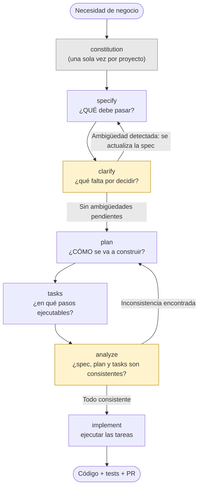

# Teoría — Módulo 3: Spec-Driven Development con GitHub Spec Kit

## 1. Fundamentos de Spec-Driven Development

En un flujo de **"prompt-to-code"**, el requisito pasa directamente del pedido informal a la implementación: la interpretación queda mayormente dentro del modelo y es difícil de auditar o repetir.

En **Spec-Driven Development (SDD)**, el requisito se transforma primero en artefactos intermedios explícitos y versionables (especificación, plan, tareas) **antes** de generar código. Esto aporta:

- **Trazabilidad:** se puede seguir el camino desde el requisito de negocio hasta el código.
- **Claridad:** ambigüedades se resuelven antes de escribir código, no durante la revisión del PR.
- **Control:** el equipo aprueba la especificación y el plan, no solo el resultado final.

## 2. GitHub Spec Kit y el CLI `specify`

GitHub Spec Kit es un toolkit que estructura el flujo de SDD en comandos/fases reproducibles, ejecutadas típicamente a través de un agente de Copilot con el CLI `specify`. Cada comando produce un **artefacto** (un archivo versionable) que es la entrada del siguiente comando — esa cadena de artefactos es lo que hace el flujo auditable.

## 3. El flujo completo, de un vistazo

Antes de ver cada paso en detalle, conviene ver cómo se encadenan. `constitution` se redacta **una vez por proyecto** (no por funcionalidad); el resto del flujo se repite **una vez por cada funcionalidad** que se va a construir.

**Cómo leer el diagrama:**

- Las flechas hacia abajo son el camino feliz: cada comando avanza al siguiente.
- Las flechas que **vuelven hacia atrás** (`clarify → specify`, `analyze → plan`) no son errores del proceso: son el mecanismo por el cual el flujo **se corrige a sí mismo** antes de llegar a `implement`. Es mucho más barato volver de `clarify` a `specify` que descubrir la misma ambigüedad revisando un Pull Request ya implementado.
- `clarify` y `analyze` son los dos puntos de control resaltados en el diagrama: ninguno de los dos genera código, ambos existen para **detectar problemas temprano**.

## 4. Constitución del proyecto (`constitution`)

| | |
| :---- | :---- |
| **Pregunta que responde** | ¿Qué principios son innegociables para cualquier funcionalidad de este proyecto? |
| **Entrada** | Conocimiento del equipo sobre arquitectura, seguridad y calidad ya definidos (incluye lo trabajado en los Módulos 1 y 2). |
| **Salida** | `constitution.md`: principios y restricciones permanentes. |
| **Frecuencia** | Una sola vez por proyecto (se actualiza rara vez, no por cada funcionalidad). |
| **Quién la aprueba** | El equipo/tech lead, antes de especificar cualquier funcionalidad. |

Es el único paso del flujo que **no se repite** por funcionalidad: actúa como contexto de fondo para todas las especificaciones futuras, similar en espíritu a `copilot-instructions.md` pero enfocado en principios de producto/arquitectura en lugar de convenciones de código.

## 5. Especificación (`specify`)

| | |
| :---- | :---- |
| **Pregunta que responde** | ¿**QUÉ** debe pasar, desde la perspectiva de quien usa la funcionalidad? |
| **Entrada** | Una necesidad de negocio (informal) + la constitución del proyecto. |
| **Salida** | Historias de usuario y criterios de aceptación **verificables**. |
| **Quién la aprueba** | La persona que pidió la funcionalidad / Product Owner. |

Traduce una necesidad en alcance, historias de usuario y criterios de aceptación. **No debe contener decisiones de implementación** (base de datos a usar, estructura de carpetas, librerías) — eso es responsabilidad del paso `plan`. Mezclar ambas cosas es el error más común al empezar con SDD.

## 6. Clarificación (`clarify`)

| | |
| :---- | :---- |
| **Pregunta que responde** | ¿Qué le falta a esta especificación para que no queden decisiones implícitas? |
| **Entrada** | La especificación (`specify`) recién redactada. |
| **Salida** | Preguntas y respuestas que **actualizan la especificación** (o la confirman como completa). |
| **Quién participa** | Quien especificó + quien va a implementar (ambos deberían estar de acuerdo antes de seguir). |

Antes de diseñar la solución, se identifican y resuelven ambigüedades: reglas de negocio no explícitas, casos borde no contemplados, datos faltantes (ej. "¿hay un límite de longitud para el título?", "¿se permiten duplicados?"). Por eso en el diagrama `clarify` puede devolver el flujo a `specify`: su resultado no es un documento nuevo, sino una versión **más completa** de la especificación. Resolver esto aquí evita retrabajo costoso más adelante — es el punto de control más barato de todo el flujo.

## 7. Plan técnico (`plan`)

| | |
| :---- | :---- |
| **Pregunta que responde** | ¿**CÓMO** se va a construir lo que dice la especificación ya clarificada? |
| **Entrada** | La especificación clarificada (sin ambigüedades pendientes) + la constitución. |
| **Salida** | Decisiones de implementación: arquitectura, stack, endpoints, estructura de datos, restricciones técnicas. |
| **Quién lo aprueba** | Quien va a implementar (y revisor técnico, si el cambio es grande). |

Traduce la especificación aprobada en decisiones de implementación: arquitectura, stack, restricciones técnicas, integración con el resto del sistema. Aquí sí es correcto mencionar base de datos, endpoints concretos, nombres de clases/servicios — lo que en `specify` hubiera sido un error.

## 8. Descomposición en tareas (`tasks`)

| | |
| :---- | :---- |
| **Pregunta que responde** | ¿En qué pasos ejecutables, con dependencias claras, se traduce el plan? |
| **Entrada** | El plan técnico aprobado. |
| **Salida** | Lista de tareas concretas (una unidad de trabajo cada una), con sus dependencias. |
| **Quién la usa** | El agente o la persona que va a implementar, en `implement`. |

El plan se descompone en tareas ejecutables con dependencias explícitas (ej. "implementar el servicio" antes que "implementar el endpoint que lo usa"). Cada tarea debería poder verificarse de forma independiente.

## 9. Análisis de consistencia (`analyze`)

| | |
| :---- | :---- |
| **Pregunta que responde** | ¿La especificación, el plan y las tareas cuentan la misma historia? |
| **Entrada** | Especificación + plan + lista de tareas. |
| **Salida** | Un reporte de consistencia: huecos (criterios sin tarea) o excesos (tareas que implementan algo no especificado). |
| **Quién actúa sobre el resultado** | Se vuelve a `plan`/`tasks` si hay inconsistencias; se avanza a `implement` si no las hay. |

`analyze` es la segunda red de seguridad del flujo (la primera es `clarify`): revisa que **todo lo especificado tenga una tarea que lo cubra** y que **ninguna tarea implemente algo que no fue especificado** (alcance agregado "por si acaso", sin aprobación). Por eso, en el diagrama, una inconsistencia encontrada aquí regresa el flujo a `plan`, no a `implement` directamente.

## 10. Implementación guiada (`implement`)

| | |
| :---- | :---- |
| **Pregunta que responde** | ¿Cómo se construye, tarea por tarea, lo que ya fue validado? |
| **Entrada** | Tareas ya verificadas como consistentes (post-`analyze`). |
| **Salida** | Código, pruebas y, normalmente, un Pull Request. |
| **Quién lo verifica** | La persona, comparando el resultado contra la especificación original (no contra "lo que parece razonable"). |

La implementación se ejecuta contra las tareas ya validadas, y se compara el resultado contra lo especificado — no se "reinterpreta" el requisito durante la implementación. Si durante `implement` aparece una ambigüedad nueva, la señal correcta es **volver a `clarify`**, no decidirla de forma improvisada dentro del código.

## 11. Greenfield vs. brownfield

- **Greenfield:** el flujo completo aplica de forma directa, sin restricciones de sistemas existentes.
- **Brownfield:** la constitución y el plan deben incorporar explícitamente las restricciones del sistema existente (contratos de API ya publicados, esquemas de datos en uso, deuda técnica conocida) para que la especificación sea realista.

## Cierre conceptual

El valor del flujo no está en la burocracia de generar documentos, sino en **mover la toma de decisiones y la detección de ambigüedades a un punto donde corregirlas es barato**, antes de que existan líneas de código que dependan de una interpretación incorrecta. Los dos ciclos de retroalimentación del diagrama (`clarify → specify` y `analyze → plan`) son precisamente ese mecanismo.
